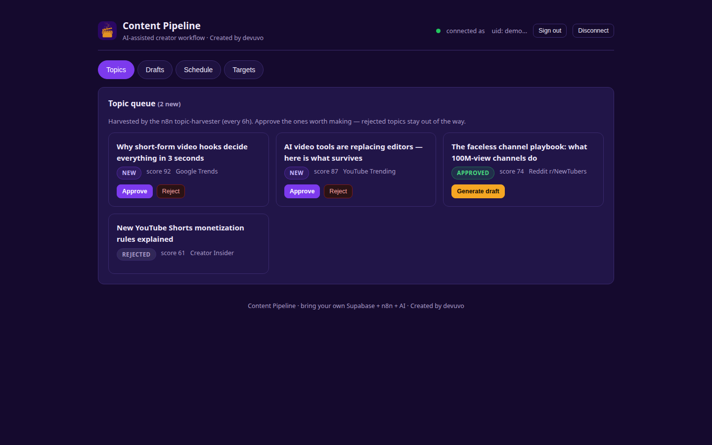
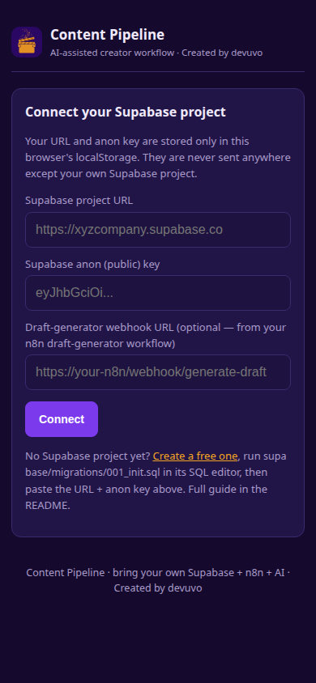

# Content Pipeline

[](LICENSE)
[](supabase/migrations/001_init.sql)
[](n8n/)
[](n8n/draft-generator.json)


*Created by devuvo*

An AI-assisted content production system for creators. **n8n** harvests trending topics and publishes on schedule; **AI** drafts the scripts; **you** approve everything in the **dashboard** (backed by **Supabase**). Human-in-the-loop at every step — the AI drafts, the human decides. Bring your own credentials — nothing is hardcoded.




## Architecture

```
                    +------------------+
                    |  n8n (your host) |
  every 6h -------> | topic-harvester  |-- RSS trends --> score --> topics (new)
                    +--------+---------+
                             | service_role key (bypasses RLS)
                             v
  on demand ------> +------------------+        +------------------+
  webhook --------> | draft-generator  |-- AI -->|  Supabase        |
  {topic_id}       | (OpenAI draft)   |  draft  |  Postgres+RLS    |<---- dashboard
                    +--------+---------+         |  + Realtime     |      (browser,
                             |                  +--------+---------+       anon key)
                    every 15 min                         ^
                             v                          |
                    | publisher        |-- queued+due -->|
                    | (YouTube/FB/IG/  |   post, mark posted/failed
                    |  TikTok)         |
                    +--------+---------+
                             |
                             v
                    YouTube / Facebook / Instagram / TikTok
```

| Piece | What it does | Credential it needs |
|---|---|---|
| n8n topic-harvester | Pulls RSS trend feeds every 6h, dedupes, scores, inserts new topics | Supabase **service_role** key |
| n8n draft-generator | Webhook `{topic_id}` → AI writes hook/script/caption/hashtags → draft row | Supabase service_role + **OpenAI API key** (your billing) |
| n8n publisher | Every 15 min posts queued items whose time has come | Supabase service_role + platform OAuth/token creds |
| Dashboard (`dashboard/index.html`) | Topic queue, draft editor, scheduler, targets, live updates | Supabase URL + **anon** key (browser localStorage only) |

## Setup (no coding required)

### 1. Create a free Supabase project
Go to [supabase.com](https://supabase.com) → New project. Wait for it to provision.

### 2. Run the migration
**SQL Editor** → New query → paste `supabase/migrations/001_init.sql` → Run. This creates `topics`, `drafts`, `publishing_targets`, `scheduled_posts`, row-level security (you only ever see your own rows), and realtime.

(Optional) `supabase/seed.sql` inserts clearly-labeled demo rows — replace `YOUR_USER_UUID` first (the dashboard shows your uid after sign-in under "connected as").

### 3. Get your keys
**Project Settings → API**: copy the **Project URL**, the **anon public** key, and the **service_role** key (Reveal). The service_role key bypasses all security rules — treat it like a password and never paste it into the dashboard.

### 4. Set up n8n
Use [n8n Cloud](https://n8n.io) (free trial) or self-host it. Import the three workflows (**Workflows → ⋯ → Import from file**):
1. `n8n/topic-harvester.json` — create a **Supabase API** credential with the service_role key; attach it to both Supabase nodes. Open the **Config** node and paste your Supabase auth user UUID. **Activate** it.
2. `n8n/draft-generator.json` — attach the Supabase credential; create an **OpenAI API** credential (platform.openai.com → API keys) and attach it to the AI node. Copy the webhook's **production URL**.
3. `n8n/publisher.json` — attach the Supabase credential; create a **Header Auth** credential per platform holding the access token (Facebook/Instagram/TikTok) and a **YouTube OAuth2** credential (Google Cloud, YouTube Data API v3 enabled). **Activate** it.

### 5. Open the dashboard
Open `dashboard/index.html` (or deploy the `dashboard/` folder to GitHub Pages / Netlify — required for the PWA install). Enter your Supabase URL + anon key, paste the draft-generator webhook URL, Connect, then sign up. Approve your first topic, hit **Generate draft**, edit, approve, schedule — the publisher takes it from there.

## v2 — Mobile app
The dashboard is an installable PWA. **Android:** Chrome → ⋮ → Install app. **iOS:** Safari → Share → Add to Home Screen. Works offline for the shell; live data needs connectivity.

## How publishing works
Each draft carries a `media_url` — the finished video file you produced. The publisher downloads it and uploads to each target. Platform APIs need approved apps/OAuth (YouTube Data API, Facebook app review, TikTok developer app) — that's on the platform side, not this repo.

## Files

```
supabase/migrations/001_init.sql  # schema, RLS, realtime
supabase/seed.sql                 # optional demo rows
n8n/topic-harvester.json          # trend harvesting (every 6h)
n8n/draft-generator.json          # AI drafting (webhook)
n8n/publisher.json                # scheduled posting (every 15 min)
dashboard/                        # PWA dashboard (manifest, sw.js, icons)
assets/logo.png
.env.example
```

## Limitations
- Publishing APIs require platform approval/OAuth setup (YouTube, Facebook, TikTok) — the workflows are ready, the platform side is yours.
- AI drafting bills to your own OpenAI account.
- n8n must stay running for harvesting and publishing.
- Trend sources are public RSS feeds; scoring is heuristic, not magic.

## License

**Free to use — just credit devuvo.** Personal, educational, and non-commercial use is free, provided you give visible credit (e.g. "Created by devuvo" with a link to https://www.devuvo.com). Business or income-generating use requires devuvo's prior approval — contact admin@devuvo.com (a license fee may apply). See [LICENSE](LICENSE) for the full terms.
